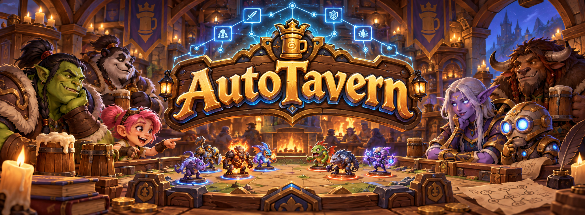
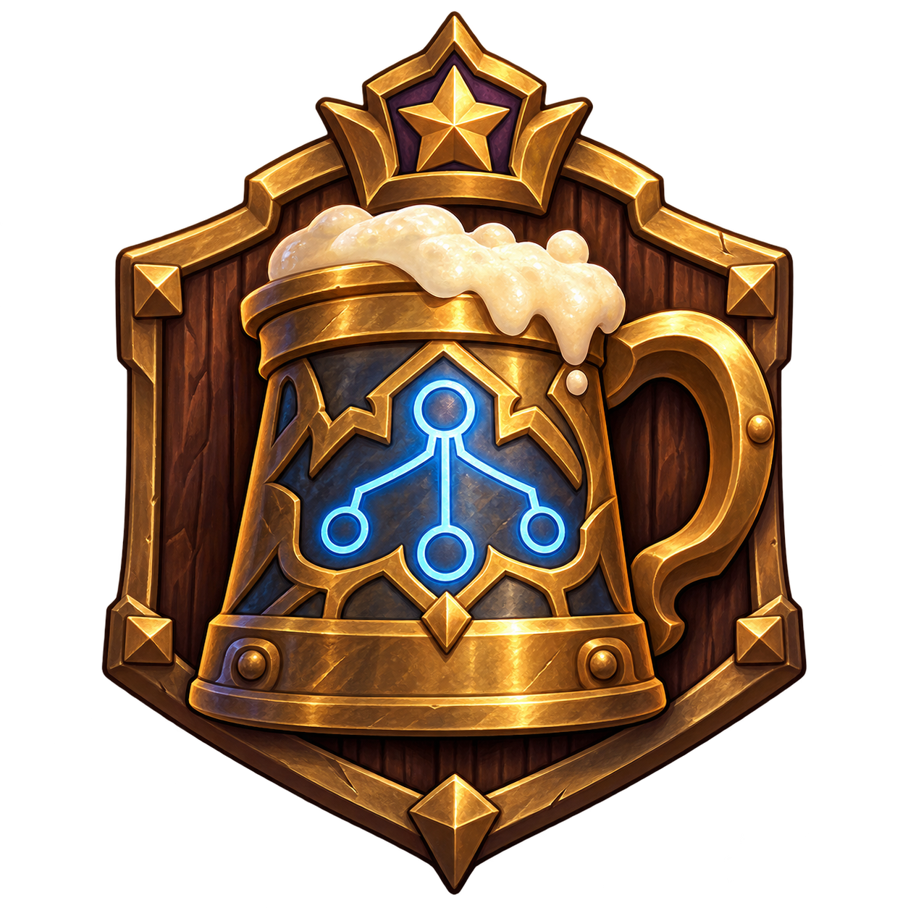

<a name="top"></a>

<p align="center">
  
</p>

<h3 align="center">TavernGym &amp; TavernBench</h3>

<p align="center">
  A fast simulator and a decision benchmark for Hearthstone Battlegrounds.
</p>

<p align="center">
  <a href="LICENSE"></a>
  <a href="pyproject.toml"></a>
  <a href="rust-toolchain.toml"></a>
  <a href="tavernbench/data"></a>
</p>

<p align="center">
  <a href="#quick-start">Quick Start</a> ·
  <a href="#taverngym">TavernGym</a> ·
  <a href="#tavernbench">TavernBench</a> ·
  <a href="#documentation">Documentation</a> ·
  <a href="#citation">Citation</a>
</p>

## Overview

AutoTavern brings the decisions of Battlegrounds into a reproducible environment for AI
research: simulate complete games, connect a learning algorithm, or evaluate a model's
judgment against a fixed set of tasks.

| [TavernGym](docs/TAVERNGYM.md) | [TavernBench](docs/TAVERNBENCH.md) |
| :--- | :--- |
| A deterministic simulator for complete eight-player games. | A benchmark for reasoning about game decisions and rules. |
| 978 game objects from patch 36.6.3, with [content coverage](docs/CONTENT.md). | 960 tasks in 40 scenarios across eight categories. |
| Rust engine, Python bindings, single-seat and batched environments. | Prompts, labels, saved states, model answers, scoring and tool-use evaluation. |

This is the code and data release for *Build, Don't Play: Self-Improving LLM Research Agents
Develop a Hearthstone Battlegrounds AI That Rivals Top Players*, by Changlian Ma and Limin
Wang, Nanjing University and Shanghai AI Laboratory.

The release includes TavernGym and TavernBench. The trained TavernAgent, its weights and
training code, and the benchmark item generators are not included.

## Quick start

```bash
git clone https://github.com/MCG-NJU/AutoTavern.git
cd AutoTavern
```

### Run a game

Install with Python 3.10 or newer and a [Rust toolchain](https://rustup.rs). The version in
[`rust-toolchain.toml`](rust-toolchain.toml) is installed automatically by rustup.

```bash
pip install .
```

```python
import taverngym

game = taverngym.Game(seed=1)
while not game.is_over():
    for seat in range(game.num_players):
        if game.needs_action(seat):
            game.step(seat, game.bot_action(seat))

print(list(game.placements()))
```

This plays a full eight-player game with the included scripted bots. Replace a bot's action
with your own legal action to control a seat.

### Score the released answers

From the repository root:

```bash
cd tavernbench
python -m tavernbench.report --set data/eval --runs results/eval \
    --systems tavernagent,gpt-6-astra,claude-opus-5.5,jev
```

This scores released answers against the labels. It needs only Python's standard library: no
simulator build, model access or API key is required.

## TavernGym

TavernGym reproduces solo Battlegrounds for client **36.6.3.253932**, server rules **36.6.3**.
It exposes the player-visible state, an exact legal action mask, and seeded save and restore.

| Interface | Use it for |
| :--- | :--- |
| `Game` | Drive any seat, inspect a game, or branch from a saved state. |
| `BattlegroundsEnv` | Connect one learning seat against seven scripted bots. |
| `BatchEnv` | Step many games together, with any set of controlled seats, including self-play. |

The learning interface provides 245 discrete actions, 3,227 numeric features and 124 card
indices per observation. Rules and lobby settings can be configured explicitly.

[Environment guide](docs/TAVERNGYM.md) · [Architecture](docs/ARCHITECTURE.md) ·
[Implemented cards](docs/CONTENT.md) · [Timewarp rules](docs/TIMEWARP.md)

## TavernBench

TavernBench tests combat predictions, warband arrangements, target choices and turn plans
with a shared prompt format and common scoring code.

| Category | Examples |
| :--- | :--- |
| Combat | Predict outcomes, damage and lethal risk. |
| Positioning | Arrange a warband against shields, cleave and deathrattles. |
| Ordering | Sequence plays, spells and triggers. |
| Targets | Choose a spell, Hero Power or minion target. |
| Selection | Choose a hero, trinket, discovery or play. |
| Strategy | Choose a turn plan: upgrade, buy, refresh or save the Gold. |
| Economy | Reason about Gold, purchases and upgrade costs. |
| Rule execution | Apply game rules to concrete actions. |

The **368-task evaluation set** is released alongside all **960 tasks**. Saved simulator
states cover the 30 play scenarios; the ten rule-execution scenarios need no state. The
released answers include TavernAgent, ten language models, Jev, and five tool-use runs.

To evaluate your own model, install the optional runners from the repository root:

```bash
pip install ".[bench]"
```

[Benchmark guide](docs/TAVERNBENCH.md) · [Task data](tavernbench/data) ·
[Released answers](tavernbench/results) · [Scoring code](tavernbench/tavernbench/score.py)

## Documentation

| Guide | Contents |
| :--- | :--- |
| [TavernGym](docs/TAVERNGYM.md) | Game APIs, batched environments, observations, actions, configuration and speed. |
| [TavernBench](docs/TAVERNBENCH.md) | Dataset layout, labels, scoring, model runners, tool use and reproduction notes. |
| [Architecture](docs/ARCHITECTURE.md) | Engine structure, interfaces and how the components fit together. |
| [Content coverage](docs/CONTENT.md) | Implemented minions, heroes, spells, trinkets and other game objects. |
| [Timewarp](docs/TIMEWARP.md) | The Timewarped Tavern (off by default in 36.6.3; two heroes still visit it). |

For development, run `pip install -e ".[test]"` and `pytest`. The Rust crate also works on its
own with `cargo test --release`.

## Citation

If you use TavernGym or TavernBench in your research, please cite:

```bibtex
@misc{ma2026build,
  title  = {Build, Don't Play: Self-Improving {LLM} Research Agents Develop a Hearthstone
            Battlegrounds {AI} That Rivals Top Players},
  author = {Ma, Changlian and Wang, Limin},
  year   = {2026},
  url    = {https://github.com/MCG-NJU/AutoTavern}
}
```

## License

Code, documentation and the TavernBench tasks, labels, states and results are released under
the [MIT License](LICENSE). Third-party game content retains its original rights; see
[NOTICE](NOTICE).

This is an independent, non-commercial research project, unaffiliated with Blizzard
Entertainment. Hearthstone and Hearthstone Battlegrounds are Blizzard trademarks. No game
client files or official game artwork are distributed, and TavernGym does not connect to
Blizzard's services. The AutoTavern banner and emblem are original generated illustrations.

<p align="center">
  <a href="#top"></a>
  <br>
  <a href="#top">Back to the tavern</a>
</p>
