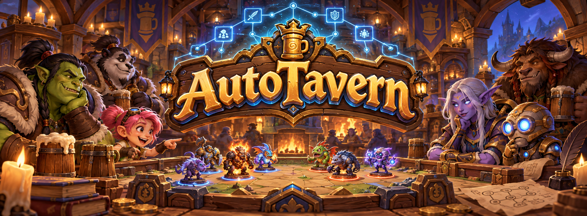
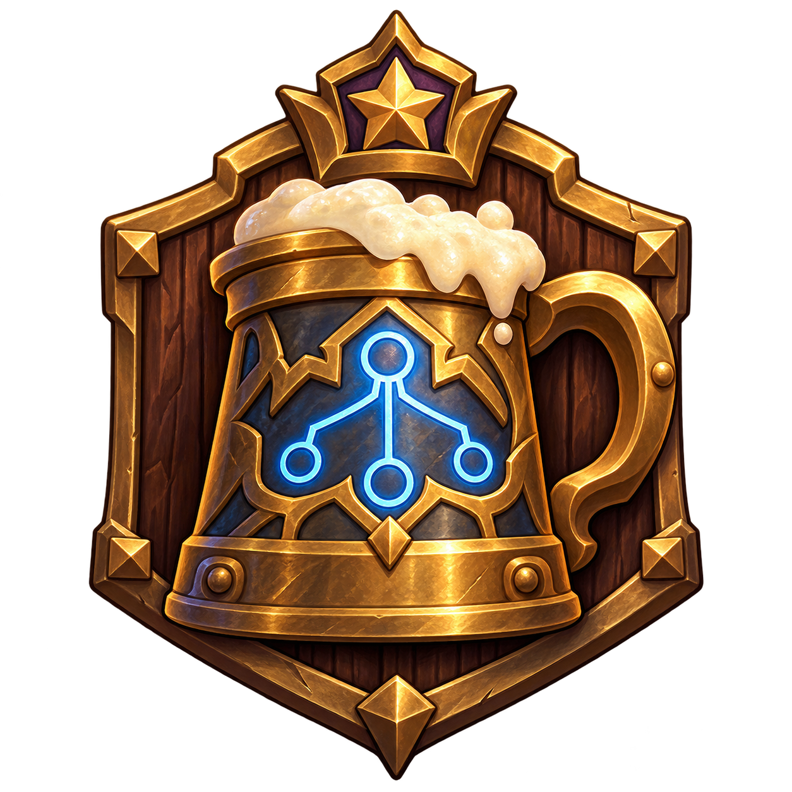

<a name="top"></a>

<p align="center">
  
</p>

<h3 align="center">TavernGym &amp; TavernBench</h3>

<p align="center"><a href="README.md">English</a> · <strong>简体中文</strong></p>

<p align="center">面向《炉石传说：酒馆战棋》的高速模拟器与决策评测基准。</p>

<p align="center">
  <a href="https://arxiv.org/abs/2610.33845v1"></a>
  <a href="LICENSE"></a>
  <a href="pyproject.toml"></a>
  <a href="rust-toolchain.toml"></a>
  <a href="tavernbench/data"></a>
</p>

<p align="center">
  <a href="#快速开始">快速开始</a> ·
  <a href="#taverngym">TavernGym</a> ·
  <a href="#tavernbench">TavernBench</a> ·
  <a href="#文档">文档</a> ·
  <a href="#引用">引用</a>
</p>

## 项目简介

AutoTavern 将酒馆战棋中的决策放入可复现的研究环境：模拟完整对局、接入自己的学习算法，或用固定任务评估模型对游戏决策与规则的判断。

| [TavernGym](docs/TAVERNGYM.md) | [TavernBench](docs/TAVERNBENCH.md) |
| :--- | :--- |
| 支持完整八人对局的确定性模拟器。 | 面向游戏决策与规则推理的评测基准。 |
| 当前对应游戏版本 37.0.2，详见[内容覆盖](docs/CONTENT.md)。 | 960 道任务、40 个场景、8 个类别。 |
| Rust 引擎、Python 绑定、单席位和批量环境。 | 提示词、标签、保存状态、模型答案、评分及工具调用评测。 |

本仓库是论文 [*Build, Don't Play: Self-Improving LLM Research Agents Develop a Hearthstone Battlegrounds AI That Rivals Top Players*](https://arxiv.org/abs/2610.33845v1) 的代码与数据发布，作者为南京大学、上海人工智能实验室的 Changlian Ma 与 Limin Wang。

发布内容包括 TavernGym 和 TavernBench；**不包含训练后的 TavernAgent、模型权重、训练代码及评测任务生成器**。

TavernGym 已更新至 **37.0.2**，见[版本说明](docs/PATCH_37.0.2.md)。TavernBench 保留论文所用 **36.6.3** 的原始题目、标签、保存状态和评测结果。复现历史模拟器或工具调用实验请使用 `v1.0.0`；使用当前引擎执行工具调用时，采用的是 37.0.2 规则。

## 快速开始

```bash
git clone https://github.com/MCG-NJU/AutoTavern.git
cd AutoTavern
```

### 运行一局游戏

需要 Python 3.10 及以上版本和 [Rust 工具链](https://rustup.rs)。rustup 会自动安装 [rust-toolchain.toml](rust-toolchain.toml) 指定的版本。

```bash
pip install .
```

```python
import taverngym

game = taverngym.Game(seed=1)
while not game.is_over():
    for seat in range(game.num_players):
        if game.needs_action(seat):
            game.step(seat, game.bot_action(seat))

print(list(game.placements()))
```

这会使用内置规则机器人完成一局八人游戏。将机器人的动作替换为自己选择的合法动作，即可控制相应席位。

### 对已发布的答案评分

从仓库根目录执行：

```bash
cd tavernbench
python -X utf8 -m tavernbench.report --set data/eval --runs results/eval \
    --systems tavernagent,gpt-6-astra,claude-opus-5.5,jev
```

评分只依赖 Python 标准库，无需编译模拟器、访问模型或提供 API 密钥。`-X utf8` 使中文 Windows 等环境也按 UTF-8 读取结果文件。

## TavernGym

当前模拟器对应酒馆战棋客户端 **37.0.2.256589**、服务器规则 **37.0.2**，提供玩家可见状态、精确合法动作掩码，以及带随机种子状态的保存与恢复。

| 接口 | 用途 |
| :--- | :--- |
| `Game` | 控制任意席位、检查游戏，或从保存状态分叉推演。 |
| `BattlegroundsEnv` | 一个学习席位对战七个规则机器人。 |
| `BatchEnv` | 同时推进多局游戏，可控制任意席位组合，包括自博弈。 |

学习接口仍为 **245 个离散动作**，每个观察包含 **3,227 个数值特征**和 **124 个卡牌索引**。游戏规则与大厅设置可以显式配置，本次补丁不改变这些接口或观测维度。

[环境指南](docs/TAVERNGYM.md) · [引擎架构](docs/ARCHITECTURE.md) · [卡牌实现覆盖](docs/CONTENT.md) · [时空酒馆规则](docs/TIMEWARP.md)

## TavernBench

TavernBench 使用统一的提示格式与评分代码，评估战斗预测、站位、目标选择、操作顺序和回合规划等决策。

| 类别 | 任务示例 |
| :--- | :--- |
| 战斗 | 预测胜负、伤害及致死风险。 |
| 站位 | 应对圣盾、顺劈与亡语的阵容排序。 |
| 顺序 | 安排打牌、施法与效果触发顺序。 |
| 目标 | 选择法术、英雄技能或随从效果的目标。 |
| 选择 | 选择英雄、饰品、发现选项或打出的牌。 |
| 策略 | 规划升级、购买、刷新或保留铸币。 |
| 经济 | 推理铸币、购买与升级费用。 |
| 规则执行 | 按游戏规则执行给定操作。 |

论文使用的 **368 道评测子集**与全部 **960 道任务**均已发布。30 类操作场景提供模拟器保存状态，10 类规则执行场景不需要保存状态。公开结果包括 TavernAgent、10 个语言模型、Jev 以及 5 组工具调用实验。

如需评估自己的模型，请从仓库根目录安装可选依赖：

```bash
pip install ".[bench]"
```

原始题目、标签和答案不会随游戏版本更新而重新生成。对已发布答案评分仍使用原始标签；在新版模拟器中执行这些场景属于新实验，其结果可能与论文不同。

[评测指南](docs/TAVERNBENCH.md) · [任务数据](tavernbench/data) · [公开答案](tavernbench/results) · [评分代码](tavernbench/tavernbench/score.py)

## 文档

下列详细技术文档目前为英文：

| 文档 | 内容 |
| :--- | :--- |
| [TavernGym](docs/TAVERNGYM.md) | 游戏 API、批量环境、观测、动作与配置。 |
| [TavernBench](docs/TAVERNBENCH.md) | 数据布局、标签、评分、模型运行器与工具调用。 |
| [引擎架构](docs/ARCHITECTURE.md) | 引擎结构、接口与模块协作。 |
| [内容覆盖](docs/CONTENT.md) | 已实现的随从、英雄、法术、饰品等。 |
| [时空酒馆](docs/TIMEWARP.md) | 当前默认关闭的时空酒馆系统；部分英雄仍可进入。 |
| [37.0.2 更新](docs/PATCH_37.0.2.md) | 本次规则更新、数据来源与版本兼容说明。 |

开发时可运行 `pip install -e ".[test]"`，再执行 `python -X utf8 -m pytest`。Rust 引擎也可独立验证：`cargo test --release`。

仓库已包含编译所需的卡牌数据库。重新生成数据库需要另外提供资源包，详见 `tools/gen_carddb.py --bundle DIR`，正常安装无需执行此步骤。

## 引用

如在研究中使用 TavernGym 或 TavernBench，请引用：

```bibtex
@misc{ma2026build,
  title  = {Build, Don't Play: Self-Improving {LLM} Research Agents Develop a Hearthstone
            Battlegrounds {AI} That Rivals Top Players},
  author = {Ma, Changlian and Wang, Limin},
  year   = {2026},
  eprint = {2610.33845},
  archivePrefix = {arXiv},
  primaryClass = {cs.AI},
  url    = {https://arxiv.org/abs/2610.33845v1}
}
```

## 许可证

代码、文档以及 TavernBench 的题目、标签、状态和结果采用 [MIT 许可证](LICENSE)。第三方游戏内容的权利归原权利人所有，详见 [NOTICE](NOTICE)。

本项目为独立、非商业研究项目，与暴雪娱乐没有隶属关系。Hearthstone 与 Hearthstone Battlegrounds 是暴雪娱乐的商标。本仓库不分发游戏客户端文件或官方游戏美术，TavernGym 不连接暴雪服务。AutoTavern 横幅与徽章为独立生成的插画。

<p align="center">
  <a href="#top"></a>
  <br>
  <a href="#top">返回顶部</a>
</p>
